# web-gradebook

Офлайн-первый PWA-журнал преподавателя: предметы, группы и подгруппы, занятия и сессии, баллы,
посещаемость, дедлайны, статистика и полный бэкап JSON.

**MVP, синхронизация Supabase (этап 2), бэкап Google Drive (этап 3) и экспорт Excel (этап 4)
реализованы в версии 0.11.** Облачные функции включаются публичными ключами сборки; без них
приложение работает полностью офлайн.

- Стек: React 18 + Vite + TypeScript, Dexie (IndexedDB), Tailwind CSS 4, `lucide-react`, `vite-plugin-pwa`.
- Единственный источник истины для интерфейса — IndexedDB; сеть никогда не блокирует выставление
  баллов. Supabase и Google Drive — опциональные надстройки.
- Интерфейс на русском, две темы, mobile-first, без эмодзи и градиентов.
- Дизайн — редакционный журнал: Literata + Golos Text, бумага и чернила, синий/сливовый/бирюзовый
  для подгрупп. Подробности и токены — [docs/DESIGN.md](docs/DESIGN.md).

## Быстрый старт

```bash
npm install
npm run dev      # http://127.0.0.1:5173/web-gradebook/
npm run build    # typecheck + production build в dist/
npm run preview  # локальный просмотр production-сборки
```

На пустом экране есть кнопка **«Посмотреть на демо-данных»**: два предмета, две группы,
подгруппы, прошедшие и будущие сессии, оценки, посещаемость и просроченные дедлайны.

## Скриншоты

| | |
| :---: | :---: |
|  | 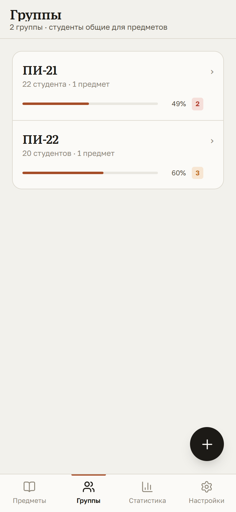 |
| 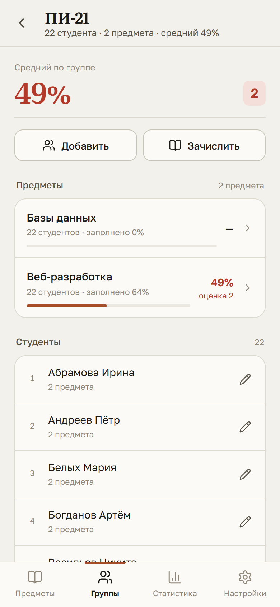 | 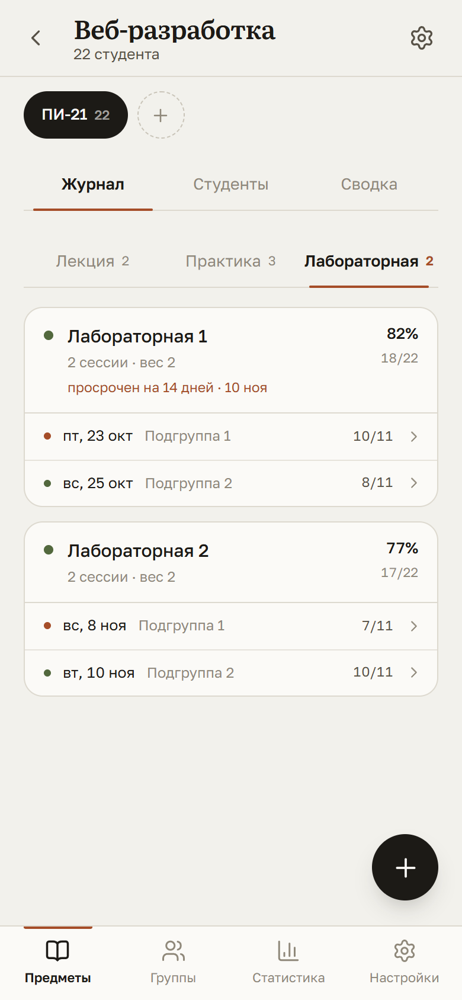 |
|  |  |
| 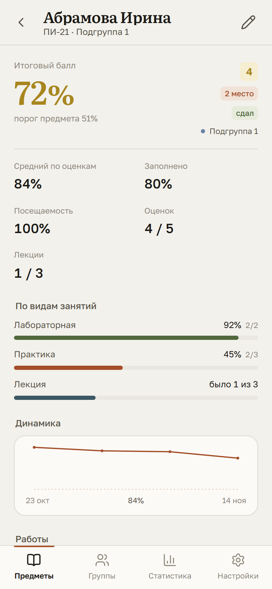 | 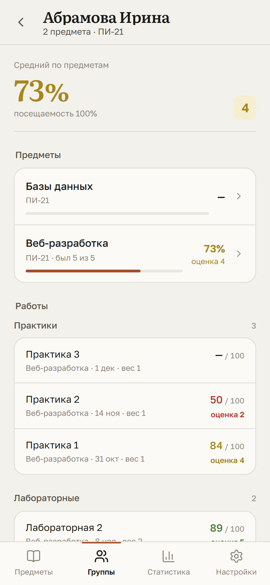 |
| 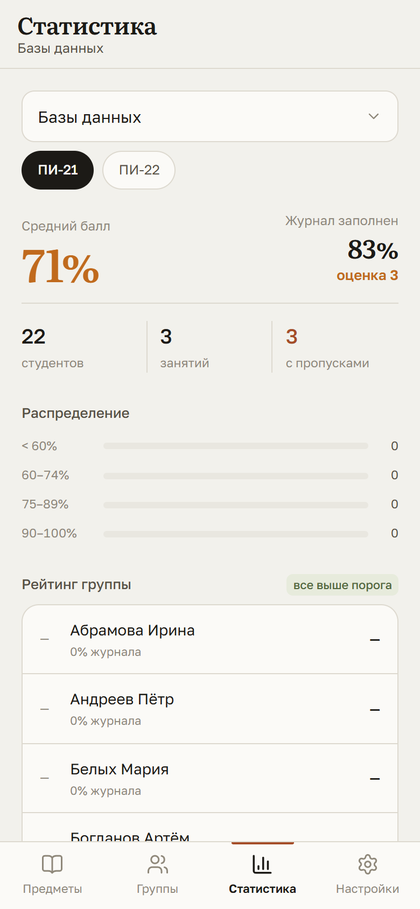 | 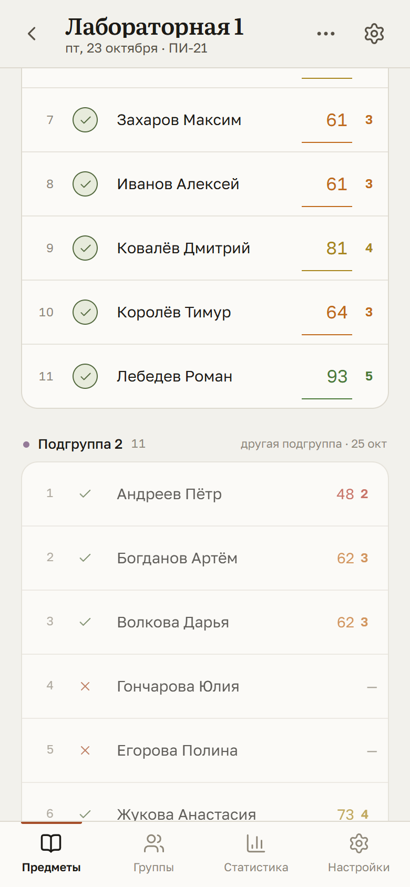 |
| 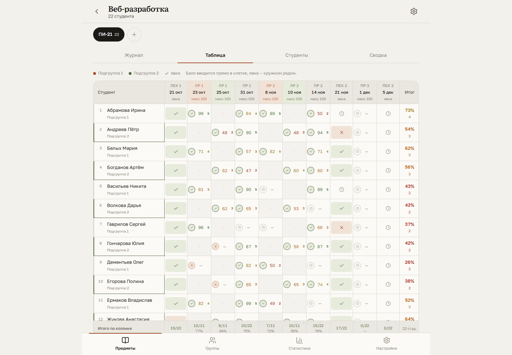 | 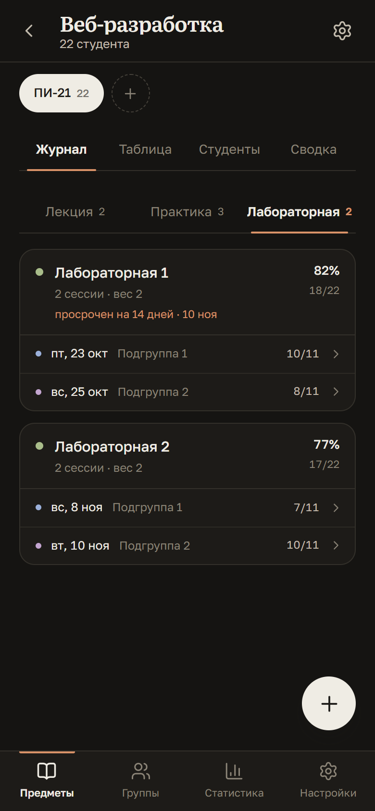 |
| 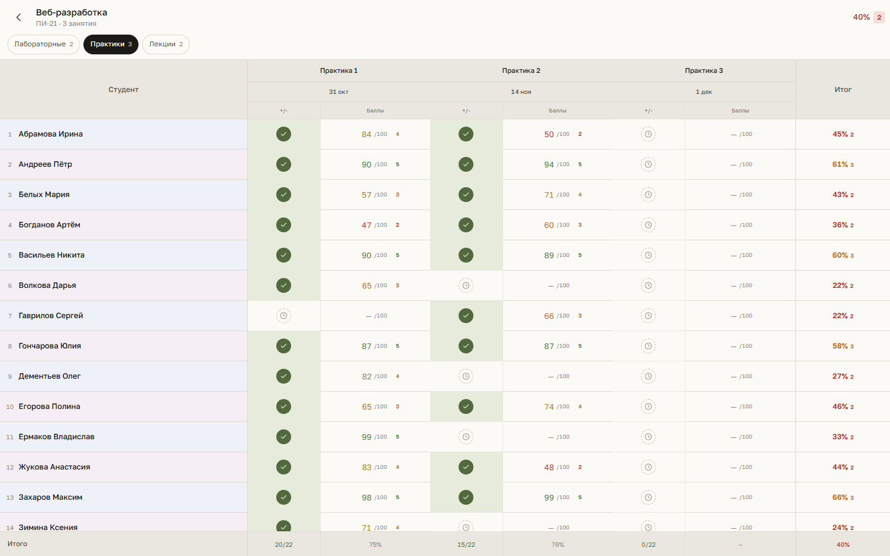 |  |
| 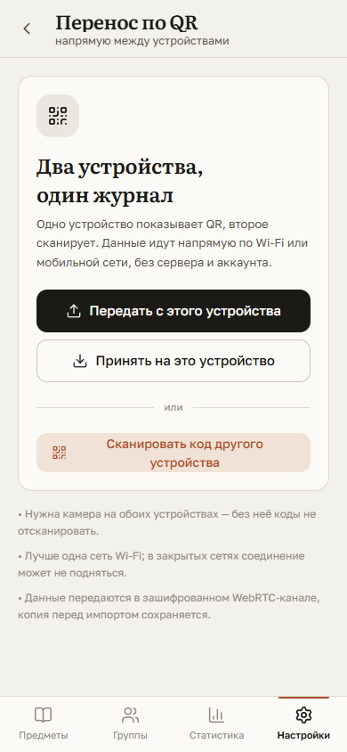 | 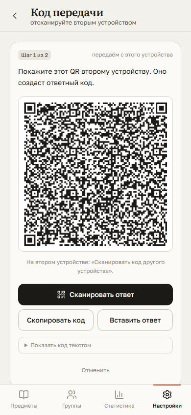 |
| 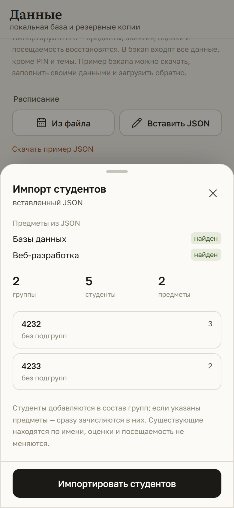 | |

## Что уже работает

| Блок | Возможности |
| :--- | :--- |
| Предметы | создание, переименование, архив, удаление (soft-delete), шкала (0–100, 0–10, сдал/не сдал), веса видов занятий |
| Навигация | 4 вкладки: Предметы, Группы, Статистика, Настройки; из группы — в предмет и занятие, из предмета — группа-бейдж → вид → занятие |
| Группы | отдельная сущность с составом студентов: добавили один раз — зачислили в любое число предметов; переименование и удаление группы с составом и сессиями; статистика по группе и предметам |
| Студент | профиль по всем предметам: средний балл, посещаемость, предметы и работы; работы сгруппированы по видам, с предметом и без дублей |
| Оценки | шкала 2–5 с цветом: 0–50 красный, 51–70 оранжевый, 71–85 жёлтый, 86–100 зелёный; цвет балла в журнале и итоге |
| Таблица | отдельные таблицы по видам, адаптивные колонки с минимумами и горизонтальная прокрутка, полноэкранный режим с возвратом и выбором вида, итоги по студенту и колонке; липкие шапка, имена и итоги |
| Оформление | выбор темы, короткие названия предметов по первым буквам с пробелами и тире («Веб-разработка» → «В-Р», «Базы данных» → «Б Д»), плавные переходы между экранами и вкладками |
| Desktop | на широком экране приложение расширяется до 980 px, таблица показывает все колонки и прокручивается внутри; на телефоне — компактные вкладки видов и прокрутка таблицы |
| Студенты | глобальная база, состав группы, подгруппы только для лабораторных, импорт JSON по группам и сразу на несколько предметов |
| Занятия | лекции / практики / лабораторные, максимальный балл и вес, дедлайн, порядок; у лекций — только посещаемость |
| Сессии | генерация дат с чередованием подгрупп `1 → 2 → 1 → 2`, одна лабораторная на обе подгруппы, ручное переопределение даты |
| Выставление | вся группа в сессии с номерами и подсветкой подгрупп, явка «был / не был», баллы с валидацией и цветом, «Отметить всех» с отменой, комментарии, автосохранение; у другой подгруппы видны явка и цветные баллы |
| Расписание | импорт JSON из `web-schedule` файлом или вставкой: предметы, все группы, занятия и сессии создаются сразу; есть пример JSON |
| Дедлайны | по умолчанию — следующее занятие группы/подгруппы, ручное переопределение, пометки «сегодня / просрочен» |
| Статистика | итоговый взвешенный процент (без лекций), средний по оценкам, заполненность, посещаемость, разбивка, динамика, рейтинг и отстающие |
| Данные | перенос полного бэкапа JSON (v2, с составом групп), пример бэкапа, импорт студентов и расписания, локальные снимки базы, состояние IndexedDB и защита от очистки, очистка базы |
| Excel | книга `.xlsx` без внешних библиотек: сводка по группам + лист на каждый предмет × группу, занятия с датами подгрупп, явка, баллы, итог, оценка и посещаемость; экспорт всего журнала или выбранного предмета |
| Синхронизация | Supabase: вход через Яндекс ID, pull/push по `updatedAt`, мягкие удаления, статус в настройках; офлайн-правки уходят при появлении сети |
| Перенос по QR | WebRTC DataChannel между двумя устройствами без сервера: SDP сжимается в QR, данные идут напрямую; копия перед импортом, LWW-слияние |
| Бэкап в облако | Google Drive `appDataFolder`: 10 JSON-файлов по сторам, автосохранение после изменений, восстановление с LWW-слиянием |
| Доступ | локальный PIN (SHA-256 + соль), автоблокировка после простоя |
| PWA | манифест, service worker, офлайн-кэш, установка на телефон, нижняя навигация на всех экранах |

## Группы — одна сущность на все предметы

Группа живёт отдельно от предмета: у неё есть состав студентов, и один и тот же студент не
импортируется заново для каждой дисциплины.

- **Группы → группа → «Добавить»** — в состав можно добавить существующего студента, создать нового
  или вставить список.
- **«Зачислить»** — выбираете предмет, и все студенты группы попадают в его журнал; подгруппы для
  лабораторных распределяются по кругу.
- Если группа уже зачислена в предмет, новый студент автоматически попадает и в него.
- **Предмет → «+» у групп** умеет зачислить существующую группу целиком, а не только создать новую.
- На экране группы — средний балл, предметы с оценками и студенты с номерами. Тап по студенту
  открывает его профиль по всем предметам.
- Шестерёнка в шапке группы — переименование и удаление: состав, зачисления и сессии скрываются,
  студенты и предметы остаются в базе.

## Профиль студента и работы

Профиль (`/students/:id`) собирает все предметы студента:

- средний балл и посещаемость по всем предметам;
- карточки предметов с итогом, оценкой и переходом в журнал;
- работы **сгруппированы по видам** — практики, лабораторные, лекции;
- у каждой работы написан предмет, дата, вес и цветной балл; для «сдал / не сдал» — статус;
- одна работа показывается один раз: занятия других групп и пустые сессии больше не дублируются.


## Шкала оценок

Проценты переводятся в привычные 2–5 и окрашиваются одинаково везде:

| Процент | Оценка | Цвет |
| :--- | :---: | :--- |
| 86–100 | 5 | зелёный |
| 71–85 | 4 | жёлтый |
| 51–70 | 3 | оранжевый |
| 0–50 | 2 | красный |

Цвет виден прямо при вводе балла за лабораторную или практику: подсчёркивание, число и итоговая
оценка окрашиваются по шкале. Для предметов «сдал / не сдал» балл зелёный при прохождении порога и
красный ниже порога. Порог по умолчанию — 51%.


### Другая подгруппа на экране выставления

Когда открыта лабораторная одной подгруппы, ниже видна вторая: дата её занятия, кто был или не
был (зелёная галочка / красный крест) и баллы с оценками в тех же цветах. Ничего не нужно
переключать, чтобы сверить обе подгруппы.


## Таблица журнала

Вкладка **«Таблица»** делит журнал на отдельные таблицы по видам занятий: **лабораторные,
практики, лекции**. Вкладка вида появляется только если по нему есть занятия.

- строки — студенты с номерами; подгруппы заметны цветом клетки и строки;
- колонка занятия: название, под ним даты подгрупп через «/», ниже две колонки — «+/-» и «Баллы»;
- явка — цветная клетка с галочкой или крестом (без подписей), балл — значение, максимум и цветная оценка;
- липкие шапка, колонка имён и строка итогов; на телефоне таблица прокручивается вбок;
- ширина колонок адаптивная с минимумом: при большом числе занятий таблица расширяется и прокручивается, клетки не сжимаются и не накладываются;
- над таблицей — число занятий, средний процент и оценка по выбранному виду;
- кнопка **«Весь экран»** открывает таблицу без нижней навигации: компактная шапка с возвратом,
  названием предмета, группой и переключателем вида занятия;
- снизу — посещаемость и средний процент по колонкам, справа — итог по виду занятий.

На desktop приложение расширяется до 980 px: таблица занимает весь экран и показывает больше
колонок, чем на телефоне. На телефоне виды переключаются компактными вкладками, клетки остаются
крупными для пальца.


## Excel

Кнопка **«Скачать журнал Excel»** в «Данных» собирает книгу `.xlsx`: лист «Сводка» и отдельный
лист на каждую пару «предмет × группа». На листе — шапка занятия с датами подгрупп, две колонки
«Явка» и «Балл», студенты с подгруппами, итог, оценка и посещаемость, средняя строка и закреплённая
шапка. Баллы окрашены по шкале 2–5, явка — зелёным/красным.

На экране предмета та же кнопка в шапке выгружает только этот предмет (и выбранную группу).
Генератор написан без SheetJS: ZIP + OOXML собираются в `src/lib/xlsx.ts`, поэтому офлайн-бандл не
тянет лишнюю библиотеку.

## Синхронизация и бэкап в облако

Обе функции опциональны и включаются ключами сборки — см. [docs/SETUP_CLOUD.md](docs/SETUP_CLOUD.md).

- **Supabase** — вход через Яндекс ID, синхронизация между устройствами. Pull читает все строки
  пользователя, push отправляет «грязные» сторы; конфликты решает `sync_upsert` на сервере по
  `updated_at`. PIN и тема не синхронизируются.
- **Google Drive** — страховочная копия в скрытой `appDataFolder`, отдельный OAuth со scope
  `drive.appdata`. Файлы перезаписываются целиком, восстановление сливает записи по `updatedAt`.
- Изменения копятся локально и отправляются при возврате в приложение, по кнопке и по таймеру;
  офлайн ничего не блокируется.

## Перенос по QR

Два устройства могут обменяться журналом напрямую, без сервера и аккаунта:

1. На первом устройстве: **Данные → Передать по QR** → «Передать» или «Принять».
2. Оно показывает QR с WebRTC-offer. На втором устройстве: «Сканировать код другого устройства».
3. Второе устройство сканирует код и показывает ответный QR; первое сканирует его камерой.
4. Открывается зашифрованный DataChannel, журнал передаётся и сливается по `updatedAt`.

SDP с ICE-кандидатами сжимается gzip и укладывается в один QR (обычно 0,6–1 КБ). Данные идут
напрямую; STUN используется только для обнаружения адресов, TURN-сервера нет. Нужны камеры на
обоих устройствах и желательно одна сеть Wi-Fi — в сложных NAT соединение может не подняться.
Перед импортом на принимающем устройстве создаётся локальная копия; более новые записи не
перетираются. Если камера недоступна, код можно вставить текстом.

## Локальные копии

В «Данных» есть автоматические снимки базы: раз в 6/12/24/72/168 часов (по умолчанию раз в
сутки), плюс ручная кнопка «Создать копию». Хранятся 8 автоматических и 6 ручных снимков; перед
импортом и очисткой копия создаётся сама. Любой снимок можно скачать JSON-файлом или восстановить
(текущее состояние тоже сохраняется отдельной копией).

Это защита от ошибочных правок, неудачного импорта и случайного удаления. Браузер не позволяет
молча писать файл на диск, поэтому снимки лежат в IndexedDB; от потери устройства защищают JSON и
Google Drive. На Chromium-десктопе можно отдельно добавить автосохранение в выбранную папку через
File System Access API.

## Пример бэкапа

В «Данных» рядом с импортом есть **«Скачать пример бэкапа»** — валидный JSON со всеми разделами
(предметы, группы и состав, занятия, сессии, оценки, явка). Его можно открыть, заменить данные
своими и загрузить обратно через «Импортировать бэкап».

## Импорт расписания

Вкладка «Данные» → «Из файла» или «Вставить JSON» принимает плоский JSON проекта
[web-schedule](https://github.com/ezy4me/web-schedule). Рядом кнопка «Скачать пример JSON».

```json
[
  { "time": "08:00", "dates": ["07.09", "14.09"], "group": "ИС-21",
    "type": "лек", "subject": "Проектирование интерфейсов" }
]
```

Каждая дата становится занятием с одной сессией, все группы из `group` создаются сразу,
лабораторные получают две подгруппы и чередование `1 → 2`, год выбирается в предпросмотре.
Лекции импортируются в режиме «только посещаемость». Студенты добавляются отдельно — в JSON
расписания их нет.

## Импорт студентов

Вкладка «Данные» → «Студенты»: файл или вставка JSON, рядом пример. Группа — самостоятельная
сущность, поэтому в JSON можно сразу указать несколько предметов.

```json
{
  "subjects": ["Веб-разработка", "Базы данных"],
  "groups": [
    {
      "name": "4232",
      "students": [
        { "name": "Иванов Иван", "subgroup": 1 },
        { "name": "Петрова Мария", "subgroup": 2 }
      ]
    }
  ]
}
```

Поддерживается и плоский список: `[{ "name": "...", "group": "4232", "subgroup": 1 }]`, а также
старый формат с одним `subject`. Студенты ищутся по имени в глобальной базе, существующие
переиспользуются. Без `subjects` студенты просто попадают в состав группы — зачислить её в предметы
можно на экране группы. Оценки и посещаемость не затрагиваются.

Полный бэкап этого приложения (предметы, группы и их состав, занятия, оценки, посещаемость)
импортируется в разделе «Перенос данных» — удобно, чтобы перенести журнал с другого устройства.


## Структура проекта

```
src/
  db/            типы, Dexie-схема (v2: группы и состав), репозиторий, бэкап, импорт, демо-данные
  domain/        чистые расчёты: оценки/веса, расписание и дедлайны, книга Excel
  sync/          Supabase: маппинг таблиц, «грязные» сторы, pull/push, статус
  drive/         Google Drive: OAuth, выгрузка и восстановление
  transfer/      WebRTC DataChannel и QR-сигналинг для переноса без сервера
  components/    UI-кит, иконки, оболочка, экран блокировки, облачные шторки
  screens/       экраны приложения
  lib/           даты, настройки/PIN, склонения, цвета подгрупп, генератор XLSX
supabase/        SQL-схема с RLS и RPC sync_upsert, Edge Function Яндекс ID
docs/            архитектура, дизайн, настройка облака, решения
```

## Документация

- [docs/PROJECT_SPEC.md](docs/PROJECT_SPEC.md) — исходное ТЗ проекта.
- [docs/DESIGN.md](docs/DESIGN.md) — дизайн-система: токены, типографика, принципы, что изменено в 0.2.
- [docs/ARCHITECTURE.md](docs/ARCHITECTURE.md) — архитектура, схема Dexie, маппинг на Supabase,
  схема `drivestash`, синк-движки, OAuth-потоки, план этапов.
- [docs/SETUP_CLOUD.md](docs/SETUP_CLOUD.md) — пошаговое подключение Supabase/Яндекс ID и Google Drive.
- [docs/DECISIONS.md](docs/DECISIONS.md) — ответы на открытые вопросы из ТЗ и принятые решения.
- [supabase/schema.sql](supabase/schema.sql) — таблицы, индексы, триггеры и политики RLS.

## Скрипты

| Скрипт | Действие |
| :--- | :--- |
| `npm run dev` | dev-сервер с HMR |
| `npm run build` | `tsc -b` + production-сборка |
| `npm run preview` | предпросмотр `dist/` |
| `npm run typecheck` | проверка типов без сборки |
| `npm run test:e2e` | дымовой e2e (нужен запущенный `npm run dev` и Chrome/Edge) |

## Деплой

GitHub Pages, репозиторий `ezy4me/web-gradebook`, `base: '/web-gradebook/'`.
Workflow `.github/workflows/deploy.yml` собирает и публикует `dist/` при пуше в `main`.
Переменные окружения этапов 2–3 добавляются в настройках репозитория (см. `.env.example`).
